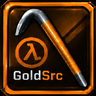
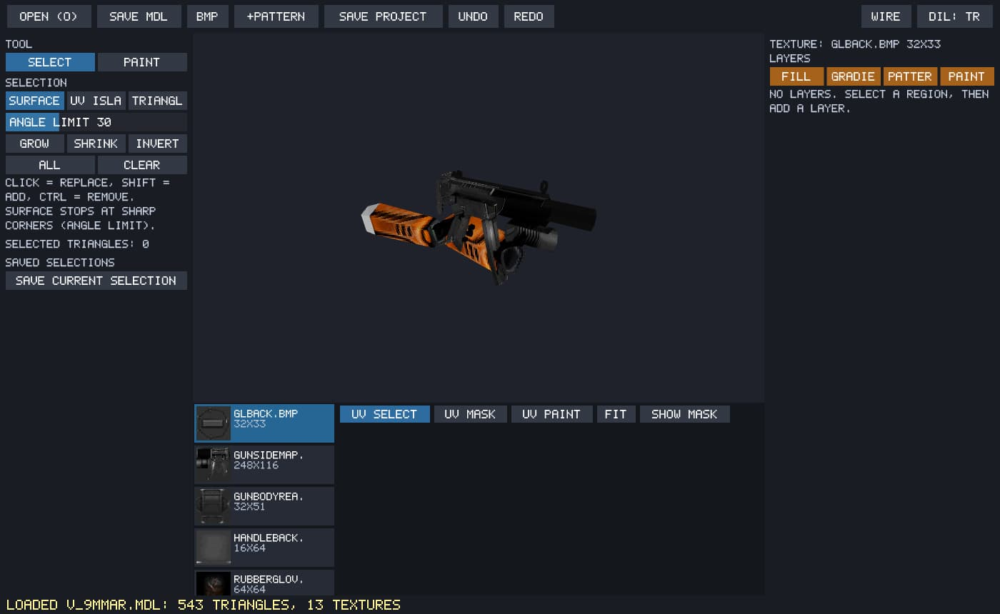

  

<h1 align="center">GoldSrc Studio</h1>

  Counter-Strike 1.6 ve GoldSrc topluluğu için araçlar, haritalar, skyboxlar ve AMXX eklentileri. 
  <a href="https://tools.bydevil.com"><b>tools.bydevil.com</b></a> ·
  <a href="https://www.goldsrcstudio.com">goldsrcstudio.com</a> ·
  <a href="https://bydevil.com">bydevil.com</a>

<a href="README.md">English</a> · <b>Türkçe</b>

  

---

## Araçlar

<table>
<tr><td width="50%" valign="top"> <b><a href="tools/map-optimization">Map Optimization</a></b> · Beta · Windows Haritanda performansın nereye gittiğini gör. wpoly ve visleaf analizi, 3D yoğunluk ve hata katmanları, HINT / info_portal optimizasyon denemeleri. <a href="https://github.com/by-devil/GoldSrcStudio/releases/download/map-optimization-beta/GoldSrcOptimization_Setup_beta.exe"><b>⬇ İndir</b></a> · <a href="https://gamebanana.com/tools/24466">GameBanana →</a></td><td width="50%" valign="top"> <b><a href="tools/studio-paint">Studio Paint</a></b> · Beta / Test · Windows Modelinin sadece istediğin parçasını boya. 3D yüzey ve UV seçimi, katmanlı ve tahribatsız boyama, degrade, desen ve 3D fırça. <a href="https://github.com/by-devil/GoldSrcStudio/releases/download/studio-paint-beta-test/GoldSrcStudioPaint_v0.1_test.zip"><b>⬇ İndir</b></a> · <a href="https://gamebanana.com/tools/24470">GameBanana →</a></td></tr>
<tr><td width="50%" valign="top"> <b><a href="tools/studio-nav">Studio Nav</a></b> · v0.30.0 Beta · Windows Botların yolunu oyunu açmadan test et. Dahili 3D BSP görüntüleyici, NAV ve PWF düzenleme, otomatik navigasyon oluşturma. <a href="https://github.com/by-devil/GoldSrcStudio/releases/download/studio-nav-v0.30.0-beta/GoldSrcStudioNav_Setup_v0.24.0.exe"><b>⬇ İndir</b></a> · <a href="https://gamebanana.com/tools/24109">GameBanana →</a></td><td width="50%" valign="top"> <b><a href="tools/skin-studio">Skin Studio</a></b> · v1.20.1 · Windows Silah skinlerini ve texture'ları tek yerden yönet. Gömülü model texture düzenleme, PNG/JPG içe aktarma ve konumlama, 3D model önizleme. <a href="https://github.com/by-devil/GoldSrcStudio/releases/download/skin-studio-v1.20.1/SkinStudio_Setup_v1.20.1.exe"><b>⬇ İndir</b></a> · <a href="https://gamebanana.com/tools/24053">GameBanana →</a> · <a href="https://github.com/serhat-ondes/CS16-Skin-Studio">GitHub →</a></td></tr>
<tr><td width="50%" valign="top"> <b><a href="tools/studio-modeler">Studio Modeler</a></b> · Beta / Test · Windows Harita fırçalarını GoldSrc modele dönüştür. .map, .rmf ve .jmf okuma, entity, group ve visgroup seçimi, canlı dokulu 3D önizleme. <a href="https://github.com/by-devil/GoldSrcStudio/releases/download/studio-modeler-beta-test/GoldSrcStudioModeler_v0.1_test.zip"><b>⬇ İndir</b></a> · <a href="https://gamebanana.com/tools/24469">GameBanana →</a></td></tr>
</table>

## Haritalar ve skyboxlar

<table>
  <tr>
    <td width="50%" valign="top">
       
      <b><a href="maps">177 Harita →</a></b> 
      Base Builder, Gun Game, Zombie Mod ve daha fazlası · 85.673 indirme
    </td>
    <td width="50%" valign="top">
       
      <b><a href="skies">108 Skybox →</a></b> 
      Counter-Strike 1.6 ve GoldSrc için gökyüzleri · 70.369 indirme
    </td>
  </tr>
</table>

## AMXX eklentileri

<table>
<tr><td width="33%" valign="top"> <b><a href="plugins/pro-public-top15">Pro Public TOP15</a></b> · 8 ekran görüntüsü Pro Public sunucuları için eksiksiz istatistik sistemi: Top15 ve süre sıralamaları, detaylı oyuncu profilleri, Steam bilgileri ve FunGun tarama geçmişi.</td><td width="33%" valign="top"> <b><a href="plugins/royal-pass">Royal Pass</a></b> · 17 ekran görüntüsü Puan ekonomisi: görevlerden puan kazan, kozmetik mağazasında harca, kutu aç, oyuncu pazarında alım satım yap.</td><td width="33%" valign="top"> <b><a href="plugins/team-system">Team System</a></b> · 9 ekran görüntüsü Takım (klan) sistemi: takım kur, üye davet et, banner ve renklerle özelleştir, sezon sıralamasında birlikte yüksel.</td></tr>
<tr><td width="33%" valign="top"> <b><a href="plugins/gungame-top15">GunGame TOP15</a></b> · 9 ekran görüntüsü Bireysel, takım ve FFA sıralamaları; puan, XP, K/D, bıçak ve seri istatistikleri, oyuncu profilleri ve sezon görünümleri.</td><td width="33%" valign="top"> <b><a href="plugins/zombie-plague-top15">Zombie Plague TOP15</a></b> · 12 ekran görüntüsü Zombie Plague için sıralama: liderle kıyaslayan profiller, rütbe yolu, özelleştirilebilir kart, sezon arşivi ve haftalık VIP ödülleri.</td><td width="33%" valign="top"> <b><a href="plugins/public-battle-pass">Public Battle Pass</a></b> · 10 ekran görüntüsü Public sunucular için sezonluk battle pass: ücretsiz ve premium seviye ödülleri, kasalar, çark ve efekt envanteri.</td></tr>
<tr><td width="33%" valign="top"> <b><a href="plugins/zombie-plague-battle-pass">Zombie Plague Battle Pass</a></b> · 9 ekran görüntüsü Haftalık sezon sistemi: her gün ücretsiz ve premium ödül, günlük görevler, coin çarkı ve mağaza.</td></tr>
</table>

[Tüm eklentiler →](plugins)

## MOTD kitleri

<table>
<tr><td width="33%" valign="top"> <b><a href="kits/sigdir">SIĞDIR + CSDurağı eksen modülü</a></b> Web MOTD sayfalarına SIĞDIR butonu ve ayar paneli ekler; bizim ek modülümüz CSDurağı istemcisine de yatay ve dikey ince ayar getirir.</td><td width="33%" valign="top"> <b><a href="kits/motd-fit">Motd-fit</a></b> Mevcut CSS dosyanızı okur ve her çözünürlük için küçültme kuralları üretir. Büyük ekranda tasarım aynen kalır, küçük ekranda yazılar ve boşluklar kademeli küçülür.</td><td width="33%" valign="top"> <b><a href="kits/csduragi-trident">CSDurağı (Trident/IE7) uyum kiti</a></b> CSDurağı MOTD’yi eski Trident motoruyla (IE7 modu) gösterir; Steam’de güzel duran CSS paneller burada bozuk veya renksiz çıkabilir. Bu kit yalnızca o istemcide izole bir düzeltme dosyası yükler.</td></tr>
</table>

[Tüm kitler →](kits)

## Hata bildirimi ve öneriler

Bir sorun bulduysan ya da yeni bir araç fikrin varsa [issue aç](../../issues).

---

GoldSrc Studio bağımsız bir projedir; Valve Corporation veya Steam ile bağlantılı değildir.
