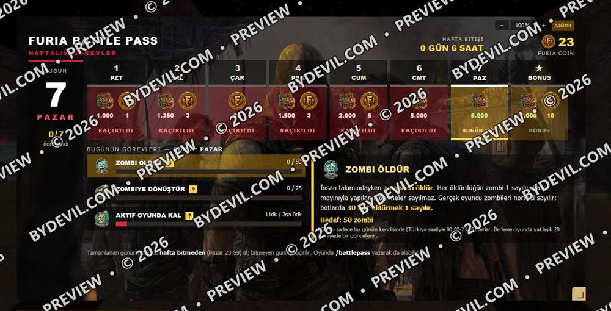
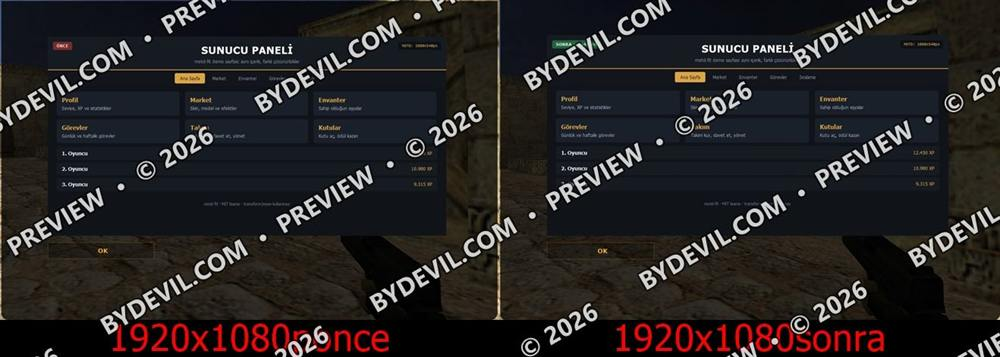
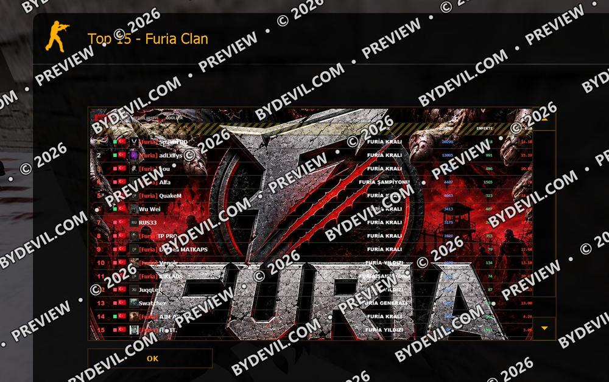

**English** · [Türkçe](README.tr.md)

# MOTD kits

Small, free kits that make CS 1.6 web MOTD panels work at every resolution and in the CSDurağı client.
On the site: [tools.bydevil.com/kits](https://tools.bydevil.com/kits/)

<table>
<tr><td width="33%" valign="top"> <b><a href="sigdir">FIT + CSDurağı axis module</a></b> Adds a FIT button and settings panel to web MOTD pages, plus our module that brings horizontal and vertical fine-tuning to the CSDurağı client.</td><td width="33%" valign="top"> <b><a href="motd-fit">Motd-fit</a></b> Reads your existing CSS and generates scale-down rules for every resolution. Your design stays the same on big screens; on small ones text and spacing shrink step by step.</td><td width="33%" valign="top"> <b><a href="csduragi-trident">CSDurağı (Trident/IE7) compatibility kit</a></b> CSDurağı renders MOTD with an old Trident engine (IE7 mode), so CSS panels that look fine in Steam can appear broken or colourless. This kit loads an isolated fix file only for that client.</td></tr>
</table>

[← Home](../README.md)
