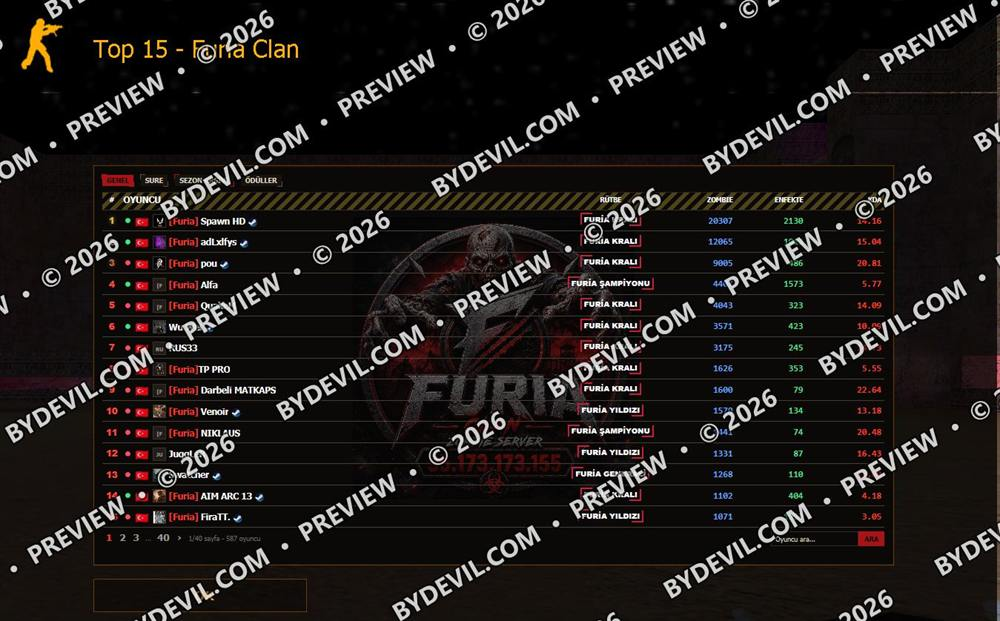

**English** · [Türkçe](README.tr.md)

# CSDurağı (Trident/IE7) compatibility kit

**CS 1.6 MOTD kit · free**

CSDurağı renders MOTD with an old Trident engine (IE7 mode), so CSS panels that look fine in Steam can appear broken or colourless. This kit loads an isolated fix file only for that client.

`PHP` · `CSS` · `Trident` · `CSDurağı`

## Features

**What is inside**  
OKUBENI.txt (quick start), STRATEJI.txt (a real case step by step), is_trident_client.php and trident-fix-template.css.

**Does not touch your CSS**  
The PHP function detects the client by User-Agent; the extra file loads only there, so Steam and browser users are not affected.

**Works with FIT**  
Built to pair with the scroll/compact-mode kit: that one fixes clicking and scrolling, this one fixes colours, alignment and backgrounds.

## Download

**[⬇ csduragimotd-kit.zip](https://tools.bydevil.com/kits/csduragi-trident/csduragimotd-kit.zip)** · 10 KB · no password

SHA-256: `0bc1e0c1037e0246784d6652e97a2a32f52865dca2abdb7d6dc4fdb102614dda`

Browse the files: [`csduragimotd-kit/`](csduragimotd-kit)

[Forum topic (webailesi.com)](https://www.webailesi.com/konu-kit-csduragi-trident-ie7-client-inda-bozuk-motd-html-panel-sorununa-cozum-37482)

## Screenshots

### Before

### After

[← All kits](../README.md)
