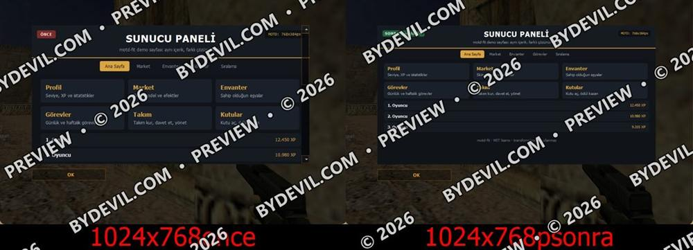
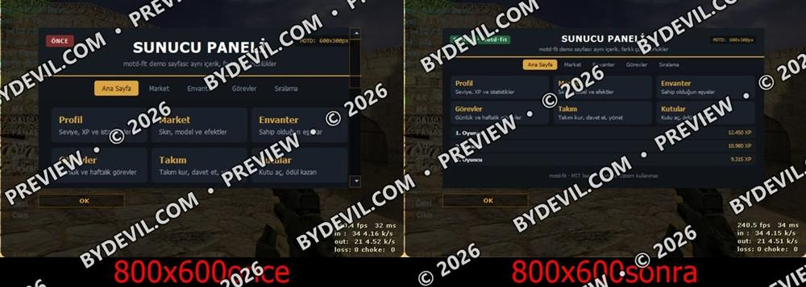
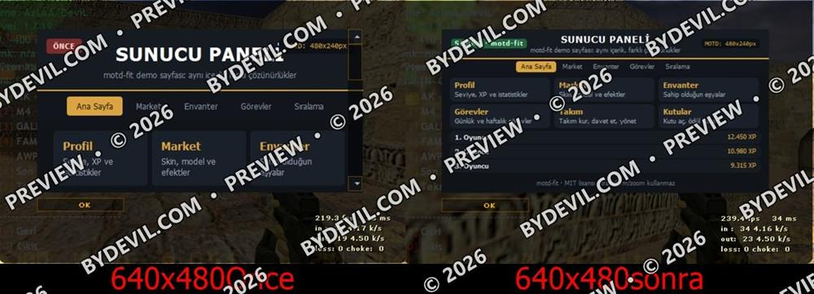

[English](README.md) · **Türkçe**

# Motd-fit

**CS 1.6 MOTD kiti · ücretsiz**

Mevcut CSS dosyanızı okur ve her çözünürlük için küçültme kuralları üretir. Büyük ekranda tasarım aynen kalır, küçük ekranda yazılar ve boşluklar kademeli küçülür.

`Python 3` · `CSS` · `13 kademe` · `Tek dosya`

## Özellikler

**Nasıl çalışır?**  
MOTD penceresi oyun yüksekliğinin yaklaşık 0,6 katıdır (1024x768 → ~460px, 800x600 → ~360px, 640x480 → ~288px). 525px’ten 265px’e 13 kademe üretir.

**Tıklama güvenli çıktı**  
transform/zoom kullanmaz; gerçek CSS değerlerini değiştirir, butonlar doğru yerden tıklanır. Küçük yazılar okunur kalır (en az 9px), ikon boşlukları korunur.

**Kullanım**  
python3 motd_fit.py style.css — CSS’i değiştirince tekrar çalıştırın, eski blok yenisiyle değişir. Öncesi/sonrası sayfalarıyla demo/ klasörü pakette.

## İndir

**[⬇ motd-fit-kit.zip](motd-fit-kit.zip?raw=1)** · 10 KB · şifresiz

SHA-256: `85a257aa08e2471e4a682bf3e9ae425f52fca4d9cba54607014fb46e1b536f59`

Dosyalara tek tek bakmak için: [`motd-fit-kit/`](motd-fit-kit)

[Forum konusu (webailesi.com)](https://www.webailesi.com/konu-kit-motd-fit-motd-sayfalarinizi-her-cozunurluge-otomatik-sigdirma-37546)

## Ekran görüntüleri

### 1920x1080 öncesi / sonrası

### 1024x768 öncesi / sonrası

### 800x600 öncesi / sonrası

### 640x480 öncesi / sonrası

[← Tüm kitler](../README.tr.md)
