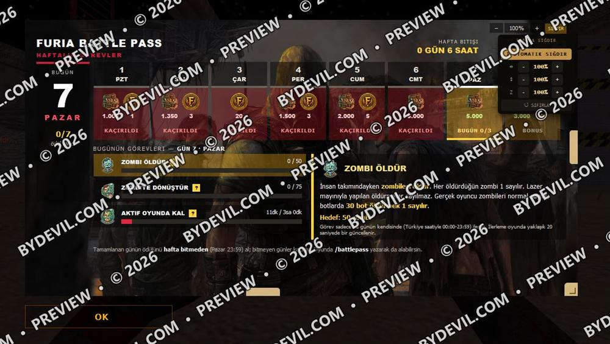

**English** · [Türkçe](README.tr.md)

# FIT + CSDurağı axis module

**CS 1.6 MOTD kit · free**

Adds a FIT button and settings panel to web MOTD pages, plus our module that brings horizontal and vertical fine-tuning to the CSDurağı client.

`PHP 5.4+` · `Steam MOTD` · `CSDurağı` · `Cookie`

## Features

**Steam MOTD and browsers**  
Auto fit, separate horizontal/vertical scaling and zoom, drag to resize; settings are remembered in a cookie.

**CSDurağı (Trident/IE7)**  
sigdir-eksen.php generates real CSS sizes on the server: no transform or zoom, so the click point never shifts. Works without JavaScript; range 50–120%.

**Requirements**  
PHP 5.4 or newer. No database, password or external library; only a cookie, no outgoing requests. README.md and demo.php included.

## Download

**[⬇ sigdir-paket.zip](https://tools.bydevil.com/kits/sigdir/sigdir-paket.zip)** · 13 KB · no password

SHA-256: `447bb7b43b7d0f0f230ee6c73322d804acfb2b12c73c49c5c8d95fe5a638e877`

Browse the files: [`sigdir-paket/`](sigdir-paket)

[Forum topic (webailesi.com)](https://www.webailesi.com/konu-kit-cs-1-6-motd-ekranina-sigdirma-kiti-csduragi-icin-yatay-dikey-ince-ayar-37529) · [Video (YouTube)](https://www.youtube.com/watch?v=XHRfSpk554c)

## Credits

FIT kit (sigdir.php, sigdir-compact-ornek.css): OSR (Serhat Ondes). Axis module (sigdir-eksen.php) and demo: Furia Clan.

## Screenshots

### Settings panel

### CSDurağı horizontal/vertical tuning

[← All kits](../README.md)
