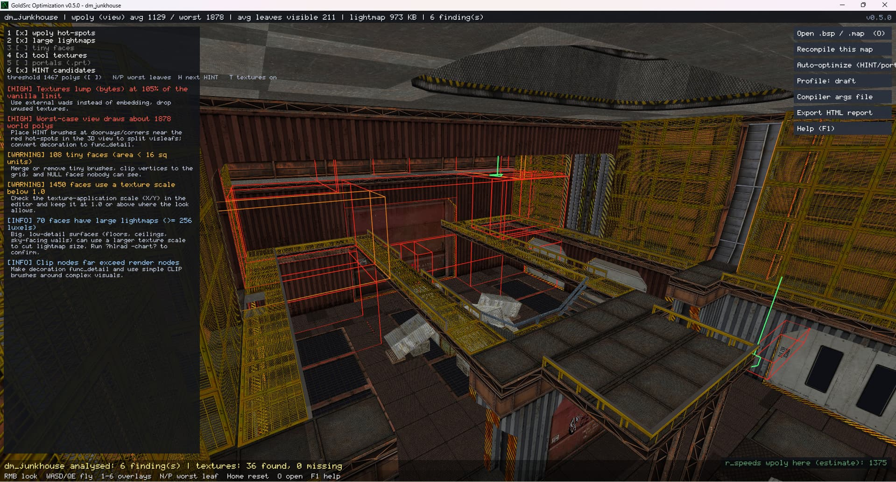

**English** · [Türkçe](README.tr.md)

# Map Optimization

**See where your map's performance is going.**

Analyse compiled BSP maps and inspect high-wpoly areas, large lightmaps and problem faces in a 3D view. Run optimization experiments with your source .map file and compare the results.

## Key features

- wpoly and visleaf analysis
- 3D density and error layers
- HINT / info_portal optimization experiments
- Recompiling with SDHLT
- HTML report export

## Details

| | |
| --- | --- |
| Category | Map optimization |
| Version | Beta |
| Platform | Windows |
| File types | `.BSP / .MAP` |
| Last updated | Oct 11, 2026 |

## Download

**[⬇ GoldSrcOptimization_Setup_beta.exe](https://github.com/by-devil/GoldSrcStudio/releases/download/map-optimization-beta/GoldSrcOptimization_Setup_beta.exe)** · 5.6 MB

SHA-256: `f88f266d3e865168aabd8b985482b3e8d4146101cd445e4062c2b6b5bf518d66`

Other links: [GameBanana](https://gamebanana.com/tools/24466)

> The tools are in beta. We recommend backing up your files before editing them.

[← All tools](../../README.md)
