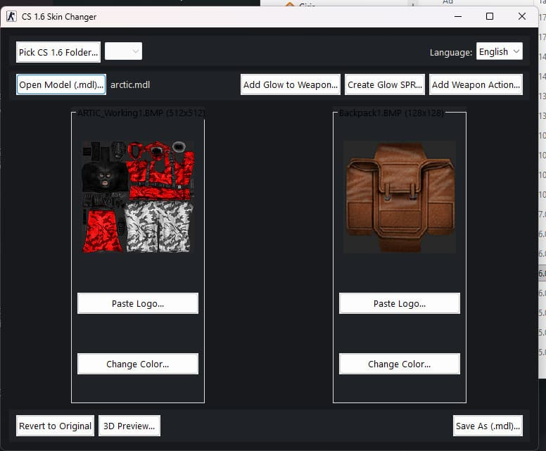

**English** · [Türkçe](README.tr.md)

# Skin Studio

**Manage weapon skins and textures in one place.**

Open GoldSrc .mdl files, edit embedded textures, add PNG/JPG images and create sprite effects. Model and texture editing in a single interface for skin makers, modders and server owners.

## Key features

- Embedded model texture editing
- PNG/JPG import and positioning
- 3D model preview
- Glow and muzzle-flash sprite creation
- wts_actions.ini output

## Details

| | |
| --- | --- |
| Category | Skins & textures |
| Version | v1.20.1 |
| Platform | Windows |
| File types | `.MDL / .SPR` |
| Last updated | Sep 11, 2026 |

## Download

**[⬇ SkinStudio_Setup_v1.20.1.exe](https://github.com/by-devil/GoldSrcStudio/releases/download/skin-studio-v1.20.1/SkinStudio_Setup_v1.20.1.exe)** · 6.7 MB

SHA-256: `44eafbc3be85f4da2e6a72f2d6101b868932f713ec2eca02f51e09293314a25b`

Other links: [GameBanana](https://gamebanana.com/tools/24053) · [GitHub](https://github.com/serhat-ondes/CS16-Skin-Studio)

> The tools are in beta. We recommend backing up your files before editing them.

[← All tools](../../README.md)
