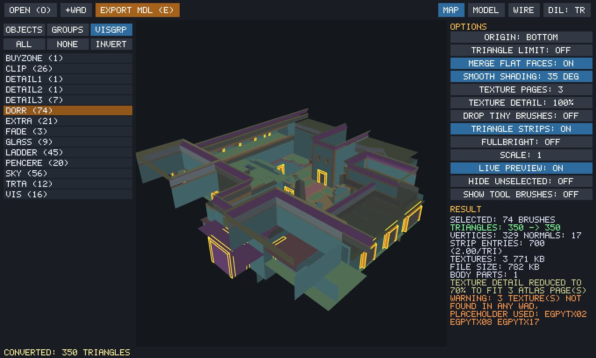

[English](README.md) · **Türkçe**

# Studio Modeler

**Harita fırçalarını GoldSrc modele dönüştür.**



Hammer, J.A.C.K. veya Jackhammer haritalarındaki fırçaları seç ve GoldSrc uyumlu düşük poli .mdl modellerine dönüştür. Canlı önizleme ile entity, group veya visgroup seç; studiomdl olmadan doğrudan model üret.

## Öne çıkan özellikler

- .map, .rmf ve .jmf okuma
- Entity, group ve visgroup seçimi
- Canlı dokulu 3D önizleme
- Gizli yüzleri temizleme ve poli birleştirme
- Doğrudan .mdl dışa aktarma

## Bilgiler

| | |
| --- | --- |
| Kategori | Harita → model |
| Sürüm | Beta / Test |
| Platform | Windows |
| Dosya türleri | `.MAP / .RMF / .JMF / .MDL` |
| Son güncelleme | 11 Ekim 2026 |

## İndir

**[⬇ GoldSrcStudioModeler_v0.1_test.zip](https://github.com/by-devil/GoldSrcStudio/releases/download/studio-modeler-beta-test/GoldSrcStudioModeler_v0.1_test.zip)** · 1.3 MB

<sub>SHA-256: `fb26d664cd645f8a56dd52e16ac4e9217825a5361bfa6639f8bd66562d0a1844`</sub>

Diğer bağlantılar: [GameBanana](https://gamebanana.com/tools/24469)

<details>
<summary><b>Kullanım kılavuzu</b></summary>

```
GoldSrc Studio Modeler  v0.1 (TEST SURUMU)
===========================================

Ne yapar?
  .map / .rmf / .jmf dosyasindaki brush'lardan GoldSrc uyumlu, optimize
  edilmis bir .mdl modeli uretir.

Nasil kullanilir?
  1) GoldSrcStudioModeler.exe'yi ac.
  2) Haritayi pencereye surukle-birak (veya "Open", O tusu).
  3) Modele cevirmek istedigin nesneyi sec:
       - "Objects" sekmesi : entity'ler (func_wall, func_detail ...)
       - "Groups" sekmesi  : RMF/JMF icindeki gruplar
       - "Visgrp" sekmesi  : Hammer'daki visgroup isimleri (DORR, LADDER ...)
       - 3D'de brush'a tikla = sec/birak, Ctrl+tikla = nesnenin tamamini sec
  4) "Model" gorunumunde sonucu canli gor (Live preview acik).
  5) "Export MDL" ile .mdl olarak kaydet.

Texture'lar:
  Haritadaki "wad" yolundan otomatik bulunur. Bulunamazsa "+WAD" ile bir
  .wad sec (ayni klasordeki diger wad'lar da otomatik yuklenir). Bulunamayan
  texture'lar kareli yer tutucu ile gosterilir ve uyari yazilir.

Ayarlar (sag panel, tiklayinca degisir):
  Origin        : modelin merkezi (alt orta / orta / haritadaki yer)
  Triangle limit: ucgen sayisini hedefe indirir (sekli bozmadan)
  Merge flat    : ayni duzlemdeki yuzleri birlestirir
  Smooth shading: yuvarlak gorunum icin normal yumusatma
  Texture pages : en fazla kac doku sayfasi (max 512x512 her biri)
  Tiling        : bake = guvenli (doku tekrarini sayfaya gomer)
                  repeat = buyuk tekrarli yuzeyler net kalir AMA oyun
                  motorunun UV'yi tekrarlamasina guvenir -> oyunda dene.

Klavye: O ac | E kaydet | F odakla | H secilmeyeni gizle | 1/2/3 gorunum
        sag tus dondur | orta tus kaydir | tekerlek yakinlastir | L dil

Bilinen eksikler (sonraki surumler):
  - Programin icinde nesne CIZME araci henuz yok (sirada).
  - Model henuz gercek oyun istemcisinde denenmedi; yapi, Valve'in 211
    orijinal modeline gore dogrulandi. Oyunda bir sorun gorursen soyle.
```

</details>

> Araçlar beta aşamasındadır. Dosyalarını düzenlemeden önce yedeklemeni öneririz.

[← Tüm araçlar](../../README.tr.md)
