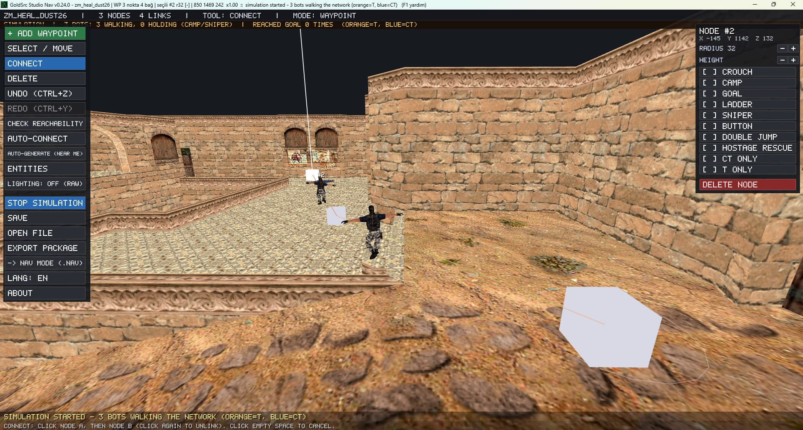

[English](README.md) · **Türkçe**

# Studio Nav

**Botların yolunu oyunu açmadan test et.**

BSP haritalarını 3D görüntüle; NAV alanları ve PWF waypoint verileriyle çalış. Bot rotalarını simüle et, harita kaynaklarını topla ve paylaşım için RES dosyası veya ZIP paketi oluştur.

## Öne çıkan özellikler

- Dahili 3D BSP görüntüleyici
- NAV ve PWF düzenleme
- Otomatik navigasyon oluşturma
- Bot rota simülasyonu
- RES ve ZIP paket oluşturma

## Bilgiler

| | |
| --- | --- |
| Kategori | Navigasyon & botlar |
| Sürüm | v0.30.0 Beta |
| Platform | Windows |
| Dosya türleri | `.BSP / .NAV / .PWF` |
| Son güncelleme | 14 Eylül 2026 |

## İndir

**[⬇ GoldSrcStudioNav_Setup_v0.24.0.exe](https://github.com/by-devil/GoldSrcStudio/releases/download/studio-nav-v0.30.0-beta/GoldSrcStudioNav_Setup_v0.24.0.exe)** · 4.2 MB

SHA-256: `641d8df5fdac0b47471254c691f442d17e3d9af9844c6e75147bd7a783e83a97`

Diğer bağlantılar: [GameBanana](https://gamebanana.com/tools/24109)

> Araçlar beta aşamasındadır. Dosyalarını düzenlemeden önce yedeklemeni öneririz.

[← Tüm araçlar](../../README.tr.md)
